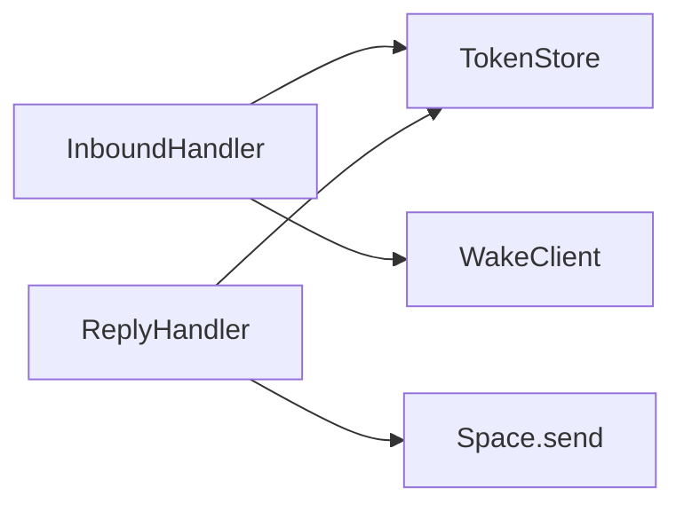

# Bridge epics (`apps/bridge`)

Scope: core loop only — Spectrum inbound → wake Grok Bot → `POST /reply` → Spectrum outbound.  
Landing (`apps/web`) and MCP are out of scope until the bridge is proven.

## Engineering bar

- **TDD:** red → green → refactor. No production code without a failing test first (except thin Spectrum wiring glue covered by contract tests).
- **Small modules, explicit deps:** inject `clock`, `fetch`, `store`, `send`. No hidden globals except process entry (`index.ts`).
- **Table-driven tests** for edge cases. Bun test runner.
- **No speculative features:** no queue, no DB, no rate-limiter framework until an epic calls for them.
- **Errors are typed results** at boundaries (`ok | reason`), not thrown control flow for expected failures.



---

## Epic 0 — Test harness & module seams

**Goal:** Make the scaffold testable without Spectrum credentials.

**Deliverables**

- `bun test` at `apps/bridge` (and root script `test:bridge`)
- Extract pure logic out of `index.ts`:
  - `TokenStore` (replace module-level `Map` + env pepper reads)
  - `WakeClient`
  - `createHttpApp({ store, … })`
  - `handleInbound({ … })` pure orchestration
- `index.ts` = wire env → deps → serve + Spectrum loop only

**Done when**

- `bun test` runs green with zero Spectrum network calls
- `index.ts` has no business branching beyond wiring

**Edge cases**

- Missing env: process still exposes `/health`; message loop skipped with a single clear log line

---

## Epic 1 — Reply token store

**Goal:** Correct one-shot, time-bounded tokens that bind a Spectrum `Space`.

**API (sketch)**

```ts
class TokenStore {
  constructor(opts: { pepper: string; ttlMs: number; now: () => number })
  mint(): string
  bind(token: string, binding: Binding): void
  consume(token: string): { ok: true; binding: Binding } | { ok: false; reason: "invalid" | "expired" | "consumed" }
}
```

**Tests first**

| Case | Expect |
|---|---|
| mint entropy | distinct tokens, URL-safe |
| bind + consume | returns binding once |
| consume twice | second → `consumed` |
| unknown token | `invalid` |
| expired (fake clock) | `expired`; entry dropped |
| hash at rest | store never retains raw token |
| wrong pepper | cannot consume tokens minted under other pepper |

**Done when**

- All table cases green
- No `process.env` inside the store (pepper injected)

---

## Epic 2 — Wake client

**Goal:** Reliable `POST` to the Grok Bot routine webhook.

**API (sketch)**

```ts
wakeGrokBot(deps: { fetch; url; key }, payload: WakePayload)
  → { ok: true } | { ok: false; status: number; body: string } | { ok: false; reason: "misconfigured" }
```

**Tests first**

| Case | Expect |
|---|---|
| happy path | `Authorization: Bearer`, JSON body exact shape |
| 200 | `ok: true` |
| 4xx/5xx | `ok: false` with status + body snippet |
| network throw | `ok: false`, no throw out |
| missing url/key | `misconfigured` |
| payload | includes `text`, `reply_url`, `reply_token`, `correlation_id`, `sent_at`, `from`, `platform` |

**Done when**

- Wake is a pure function over `fetch`
- Payload type is the single source of truth (shared with inbound)

---

## Epic 3 — `POST /reply` HTTP

**Goal:** Bot/MCP callback delivers text to the bound Space exactly once.

**Tests first** (Hono `app.request`)

| Case | Expect |
|---|---|
| missing/invalid Authorization | `401` |
| empty/whitespace text | `400` |
| invalid JSON | `400` |
| bad token | `403` `{ error: "invalid" }` |
| expired token | `403` `{ error: "expired" }` |
| already consumed | `410` `{ error: "consumed" }` |
| happy path | `200`, `space.send(text)` once |
| send throws | `502`, token already consumed **or** not consumed — **decide in test:** prefer *consume after successful send* so Bot can retry |
| correlation_id echo | response includes id from body or binding |

**Design decision (lock in this epic)**

- **Consume-after-successful-send:** failed `space.send` leaves token usable for Bot retry within TTL.
- Never trust client-supplied chat destination — only the token binding.

**Done when**

- Handler depends only on `TokenStore` + injected send path
- Idempotent duplicate after success → `410`

---

## Epic 4 — Inbound policy & orchestration

**Goal:** Decide what happens to each Spectrum message without the Spectrum SDK in unit tests.

**API (sketch)**

```ts
handleInbound(input: InboundMessage, deps: Deps): Promise<InboundResult>
// InboundResult: ignored | echoed | woken | wake_failed
```

**Tests first**

| Case | Expect |
|---|---|
| non-text content | ignore |
| empty / whitespace text | ignore |
| sender not on allowlist | ignore (when allowlist non-empty) |
| allowlist empty/null | allow all |
| wake disabled | echo via `reply`/`send` |
| wake enabled | mint+bind token, call wake with correct payload, react ack best-effort |
| wake fails | user-visible short error via `send`; no hanging token **or** token bound but unused — prefer **bind only after wake accepted** OR **unbind on wake failure** (lock: unbind/delete on wake failure) |
| own-echo / agent sender | ignore (if detectable in fixture) |

**Done when**

- `index.ts` loop is `for await … handleInbound(…)`
- Echo and wake modes covered without live Photon

---

## Epic 5 — Process wiring & live smoke

**Goal:** Runnable bridge against Spectrum (terminal and/or real iMessage line).

**Deliverables**

- Env validation helpers with clear errors
- `/health` includes: spectrum connected yes/no, wake configured yes/no
- Manual smoke checklist in `apps/bridge/README.md`
- Optional: contract test with `terminal` provider if it can be driven in CI without secrets

**Done when**

- Dev can: receive text → echo
- Dev can: receive text → wake → simulate `curl POST /reply` → reply lands in chat

**Out of epic**

- Production deploy, MCP, Astro, multi-tenant

---

## Epic 6 — Hardening (after loop works)

Only after Epic 5 smoke is green.

| Item | Notes |
|---|---|
| Wake timeout | AbortSignal on fetch |
| In-flight timeout | optional user ping if no `/reply` by TTL |
| Basic inbound rate limit | per-sender token bucket, in-memory |
| Structured logs | correlation_id on wake + reply |
| Dedup inbound | at-least-once Spectrum delivery → ignore duplicate `message.id` briefly |

---

## Suggested build order (TDD)

```
E0 harness → E1 tokens → E2 wake → E3 /reply → E4 inbound → E5 smoke → E6 harden
```

Each epic merges only with: tests green, no unused exports, no comments that narrate the code.

## Explicit non-goals (until named epic)

- MCP `send_reply` server
- Durable token store / Redis
- Spectrum webhook mode (`@spectrum-ts/hono`) — stream mode stays
- xAI Responses API path
- Landing page work
